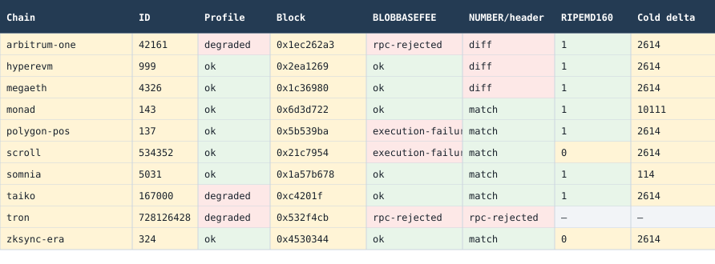

# EVM-compatible isn't EVM-equivalent: what we measured on 27 chains

"EVM-compatible" tells you your bytecode has somewhere to run. It doesn't tell you the chain has Ethereum's precompiles, its block clock, its randomness, its gas schedule or its deployment limits. Those details end up inside authorization checks, bridge verifiers, timelocks and fee logic, which is where they turn into security bugs.

Most compatibility tables are written from docs, and docs go stale. So we measured instead. Between 2026-10-18 and 2026-10-20 we sent the same 231 test cases to 27 chains: opcodes, block context, every precompile with real test vectors, 137 gas measurements, and contract size and lifecycle limits. Each test is a bit of init code sent to `eth_call` with no `to` address, so the node runs it like a deployment and hands back the result. Nothing is signed, sent or deployed. Every result keeps the endpoint, block, timestamp and raw response, and every difference below repeated at a later block (and on a second endpoint where one exists).

Here are six results that should change how you review a multi-chain deployment.

## 1. A valid BLS call "succeeds" with no answer on four chains

Ethereum's Pectra upgrade (May 2025) added BLS12-381 precompiles at `0x0b` through `0x11`. BLS12-381 is the curve Ethereum validators sign with, so these are how contracts check validator signatures: light clients, bridges, restaking. We sent a valid G1ADD (point addition) test vector from Ethereum's execution-spec tests to `0x0b` on every chain. Ethereum returned the expected 128 bytes. Avalanche C-Chain, Blast, HyperEVM and Scroll reported success and returned nothing:

```
Ethereum block 0x190407f: G1ADD 0x0b valid vector -> match, output_bytes=128
Avalanche C-Chain block 0x5d7b1a8: G1ADD 0x0b valid vector -> empty-success, output_bytes=0
Blast block 0x27e3c38: G1ADD 0x0b valid vector -> empty-success, output_bytes=0
HyperEVM block 0x2ebdab0: G1ADD 0x0b valid vector -> empty-success, output_bytes=0
Scroll block 0x21cb77a: G1ADD 0x0b valid vector -> empty-success, output_bytes=0
```

That's what calling an empty address looks like: in the EVM it doesn't fail, it succeeds with no output. The result repeated at a later block on all four, and our independent checker also reproduced Avalanche's on a second public endpoint (PublicNode). zkSync Era fails the same call outright, which is the safe way to be missing it.

A verifier that treats `success` alone as "the BLS operation ran" would carry on with empty output. Whether that turns into accepting a bad proof depends on what the verifier does next, and we didn't test any specific verifier. The pattern to avoid:

```solidity
(bool ok, bytes memory out) = address(0x0b).staticcall(input);
require(ok, "precompile failed");
```

Check the output length on every call, and run a known-answer test once at deploy:

```solidity
// on every call: G1ADD returns 128 bytes
(bool ok, bytes memory out) = address(0x0b).staticcall(input);
require(ok && out.length == 128, "no BLS precompile");

// once, in the constructor: a fixed vector with a known result
(bool kok, bytes memory kout) = address(0x0b).staticcall(KAT_INPUT);
require(kok && keccak256(kout) == KAT_HASH, "wrong precompile");
```

Evidence: [Ethereum](../results/2026-10-20/precompile-sweep/initial/ethereum.json), [Avalanche](../results/2026-10-20/precompile-sweep/initial/avalanche-c-chain.json), [Blast](../results/2026-10-20/precompile-sweep/initial/blast.json), [HyperEVM](../results/2026-10-20/precompile-sweep/initial/hyperevm.json), [Scroll](../results/2026-10-20/precompile-sweep/initial/scroll.json), and the [vector matrix](../results/2026-10-20/precompile-sweep/MATRIX.csv).

## 2. RIPEMD160 fails on zkSync Era and Scroll

RIPEMD160 at `0x03` has been on Ethereum since launch, so it's easy to assume it's everywhere. We sent the same test vector on every chain. The outer call completed everywhere, but the precompile call itself failed on zkSync Era and Scroll:

```
Ethereum block 0x1901b3a: precompile-0x03-ripemd160 -> status=1
zkSync Era block 0x4530344: precompile-0x03-ripemd160 -> status=0
Scroll block 0x21c7954: precompile-0x03-ripemd160 -> status=0
```

This is the chain refusing to run it, not the RPC refusing the request. Anything that hashes with RIPEMD160 (Bitcoin-style address derivation in a bridge, for example) breaks after deployment, even though it compiled and passed on Ethereum. Run a known-answer test on the target chain before you depend on it.

Evidence: [Ethereum](../results/2026-10-18/ethereum/ethereum.json), [zkSync Era](../results/2026-10-18/zksync-era/zksync-era.json), [Scroll](../results/2026-10-18/scroll/scroll.json), and the [focused replay on independent endpoints](../results/2026-10-18/followup/headline-probes/REPORT.json).

One result went the other way, and it's worth saying. The usual line is "zkSync's CREATE2 addresses differ from Ethereum's". For EVM bytecode, our probe got the Ethereum formula on zkSync Era (`formula_matches=true`, same as Ethereum and Arbitrum). The different formula applies to EraVM-native contracts ([zkSync docs](https://docs.zksync.io/zksync-protocol/era-vm), accessed 2026-10-18). So a checklist rule that says "zkSync CREATE2 always differs" is out of date. You still want the check, just aimed at the right kind of contract.

## 3. On Arbitrum, `block.number` is the L1 block number

Contracts use `block.number` for epochs, voting windows, replay bounds and timelocks. On Ethereum, the opcode matched the block header. On Arbitrum One it returned an Ethereum L1 block number, while the L2 header said something about 20x larger:

```
Arbitrum block tag 0x1ec262a3:
  probes.number.uint256=26221369
  block.number=516055715
  header_matches=false
Ethereum block tag 0x1901b3a:
  probes.number.uint256=26221370
  block.number=26221370
```

Arbitrum documents this, but it still catches people. Off-chain code that reads the L2 header and on-chain code that reads `block.number` are using two different clocks. A timelock or vote window computed from one and checked against the other opens at the wrong time.

Pick the unit on purpose. Seconds (`block.timestamp`) make the unit explicit. They don't remove sequencer or finality assumptions, so write those down separately.

Evidence: [Arbitrum](../results/2026-10-18/arbitrum-one/arbitrum-one.json), [block-context comparison](../results/2026-10-18/block-context-followup/COMPARISON.json), [later confirmation](../results/2026-10-18/differential-confirmation/arbitrum-one/arbitrum-one.json).

## 4. PREVRANDAO can be a constant

On Ethereum, `block.prevrandao` matched the header. On zkSync Era it returned `2500000000000000`, and on Avalanche C-Chain it returned `1`, at both blocks we checked:

```
zkSync Era block 0x4530344: uint256=2500000000000000,
  header_value=0, header_matches=false
Avalanche C-Chain block 0x5d5e583: uint256=1,
  header_value=0, header_matches=false
```

That isn't a bug in either chain. It's a bug in any contract that ported "use prevrandao as a seed" from Ethereum, where the value at least comes from the beacon chain. Here it came back as the same number at every block we checked, which anyone can read in advance.

If ordering is adversarial, use commit-reveal or a verifiable randomness source, and ask who can see or influence the value before it's used. That includes the sequencer.

Evidence: [zkSync Era](../results/2026-10-18/zksync-era/zksync-era.json), [Avalanche](../results/2026-10-18/avalanche-c-chain/avalanche-c-chain.json), [entropy follow-up](../results/2026-10-18/entropy-followup/COMPARISON.json).

## 5. Cold storage access on Monad costs about 4x Ethereum

We measured gas around a cold and then a warm `EXTCODESIZE` in the same call. On Ethereum the cold access cost 2,614 gas and the warm one 114. On Monad, cold was 10,111 and warm 112:

```
Ethereum block 0x1901b3a: gas_delta=2614, warm_gas_delta=114
Monad block 0x6d3d722: gas_delta=10111, warm_gas_delta=112
```

That lines up with Monad's documented repricing of cold access. Hardcoded gas stipends, relayer budgets and "this loop fits in a block" estimates that were tuned on Ethereum can come up short. Measure the path on the target chain instead of scaling an Ethereum number.

Evidence: [Ethereum](../results/2026-10-18/ethereum/ethereum.json), [Monad](../results/2026-10-18/monad/monad.json), [later Monad confirmation](../results/2026-10-18/differential-confirmation/monad/monad.json).

## 6. Gas is where chains drift the most

We measured 137 operations on every chain: storage reads and writes, memory growth, hashing, logs, calls and contract creation. Most chains copy Ethereum's gas schedule exactly. Seven don't, and a few by a lot:

```
empty CREATE           Tempo     500,000   Ethereum  32,000
first SSTORE (0 -> 1)  Somnia    200,100   Ethereum  22,100
first SSTORE (0 -> 1)  Sei        74,100   Ethereum  22,100
LOG4 + 256 bytes       MegaETH    39,403   Ethereum   3,923
memory to 1 MB         Monad      16,387   Ethereum 2,195,459
```

Most of these are in the chain's docs if you go looking. Tempo sets a 500,000 creation base in [TIP-1000](https://github.com/tempoxyz/tempo/blob/296be2abd6df2cf666bd68d9e3da9ca3517d6714/tips/tip-1000.md). Somnia [also requires at least 1,000,000 gas remaining](https://docs.somnia.network/developer/deployment-and-production/somnia-gas-differences-to-ethereum.md) before a new storage write, so a call can fail even when it has more than the 200,100 the write costs. Sei's storage price is set by governance, so it can change. Monad's memory is cheap but [capped at 8 MB](https://docs.monad.xyz/developer-essentials/opcode-pricing.md#memory-expansion).

The security angle is the same in every case: anything with a fixed gas budget that was sized on Ethereum. Factories and smart-account deployers that cap child creation, storage-writing hooks, relayers and paymasters with fixed allowances, and event-heavy callbacks. Monad goes the other way. Ethereum's quadratic memory cost quietly limits how much input a contract can chew through, and on Monad that brake is much weaker under the 8 MB cap, so bound your inputs explicitly.

Evidence: [gas matrix](../results/2026-10-20/gas-schedule/MATRIX.csv), [Tempo](../results/2026-10-20/gas-schedule/initial/tempo.json), [Somnia](../results/2026-10-20/gas-schedule/initial/somnia.json), [Sei](../results/2026-10-20/gas-schedule/initial/sei-evm.json), [MegaETH](../results/2026-10-20/gas-schedule/initial/megaeth.json), [Monad](../results/2026-10-20/gas-schedule/initial/monad.json), [Ethereum](../results/2026-10-20/gas-schedule/initial/ethereum.json), with later-block repeats under `gas-schedule/confirm/`.

## How we checked our own numbers

Before comparing chains, we checked the gas harness against Ethereum itself: all 209 gas readings matched the values the EIPs and Yellow Paper predict ([baseline check](../docs/gas-baseline-check.md)). Then an independent checker that didn't write the data re-tested random samples of 20 findings against live RPCs, four times. Round 1 found 7 errors, round 2 found 3, round 3 found 0, and round 4 (on the new gas, vector and limit rows) found 1 overstated consequence, which we fixed. A separate review re-ran the ten strongest new findings and tried to explain each one away; none turned out to be a measurement artifact.

## "Rejected" isn't "unsupported"

This one is about method, but it changes conclusions. When a probe fails, it matters who said no.

TRON's public RPC rejected our probe before it ever reached the VM: `-32602: QUANTITY not supported, just support TAG as latest`. That tells you something about the RPC adapter, nothing about TRON's VM. Polygon's endpoint accepted the same kind of request for `BLOBHASH(0)` and the VM failed with `-32000: invalid opcode: BLOBHASH`. That one really is a missing opcode.

We also threw out results where the endpoint, not the chain, was the cause. Some public endpoints ignore the block number you ask for and run the call against the latest block. That makes `NUMBER` and `TIMESTAMP` look wrong when they aren't. And a call that reads the code of one particular address is a fact about that address, not about the chain. An account that's 7702-delegated on Ethereum and empty on Linea isn't a difference between Ethereum and Linea.

An independent checker re-ran random samples of 20 catalog rows against live RPCs. The first round found 7 errors, mostly of those two kinds. After fixes, round two found 3, and round three found none: 18 confirmed, plus 2 that reproduced exactly but couldn't be compared against Ethereum (one endpoint ignored block numbers, one chain's header has no randomness field).

## The matrix

Only chains that differ from Ethereum in at least one of these columns are shown. `rpc-rejected` means the endpoint refused the request, not that the chain lacks the feature.



| Chain | ID | Block | BLOBBASEFEE | NUMBER vs header | RIPEMD160 status | Cold access gas |
| --- | ---: | --- | --- | --- | ---: | ---: |
| Arbitrum One | 42161 | 0x1ec262a3 | rpc-rejected | differs | 1 | 2614 |
| Monad | 143 | 0x6d3d722 | ok | match | 1 | 10111 |
| Polygon PoS | 137 | 0x5b539ba | execution-failure | match | 1 | 2614 |
| Scroll | 534352 | 0x21c7954 | execution-failure | match | 0 | 2614 |
| Somnia | 5031 | 0x1a57b678 | ok | match | 1 | 114 |
| Taiko | 167000 | 0xc4201f | ok | match | 1 | 2614 |
| TRON | 728126428 | 0x532f4cb | rpc-rejected | rpc-rejected | n/a | n/a |
| zkSync Era | 324 | 0x4530344 | ok | match | 0 | 2614 |

The full [catalog](../CATALOG.md) has every confirmed difference with its evidence, and the [auditor triage map](../docs/auditor-triage.md) links each one to a fixture and a review step.

## What we'd change in a deployment review

Start from the target chain, not from Ethereum. Concretely:

- Compile for the target's fork and check every opcode the compiler emitted, including `PUSH0`, `TSTORE` and `MCOPY`.
- Call every precompile you depend on with a known-answer vector and check the exact output, not just the success flag.
- Decide what unit your time logic uses (seconds, local blocks, L1 blocks) and write down what `block.number` and `block.timestamp` mean on that chain.
- Don't use `prevrandao` as randomness unless you know where it comes from on that chain.
- Measure gas on the target for anything with a hardcoded stipend or budget.
- Test addresses from CREATE and CREATE2 on the target VM, especially for factories and counterfactual wallets.

The probe kit runs all of this read-only with one command, so it can sit in CI and fail a release when a known answer changes on your target chain.

## Prior art and limits

This builds on [mds1/evm-diff](https://github.com/mds1/evm-diff/tree/6beeefe8a91484cf9e3c23d59b364ef3bba673b4) and [shemnon/evm-directory](https://github.com/shemnon/evm-directory/tree/f06b85450e87772221ff636aa3df29ae20f563b6), plus each chain's own docs. What we add is live, dated results with the raw responses kept.

Read-only calls can't show everything. L1-to-L2 sender aliasing, finality windows, rebasing native balances (Blast), fee-token payment (Celo, Tempo) and exact code-size limits need a real transaction or a deployment, so the catalog marks those as source-verified with pinned links rather than measured. Our Monad code-size probes at 131,072 and 131,073 bytes both returned zero, which could be an `eth_call` gas cap rather than the size rule, so we're not claiming a measured limit there.

Everything here is a dated snapshot from 2026-10-18 through 2026-10-20. Chains upgrade. That's the reason to rerun the probes rather than trust a table, this one included.
